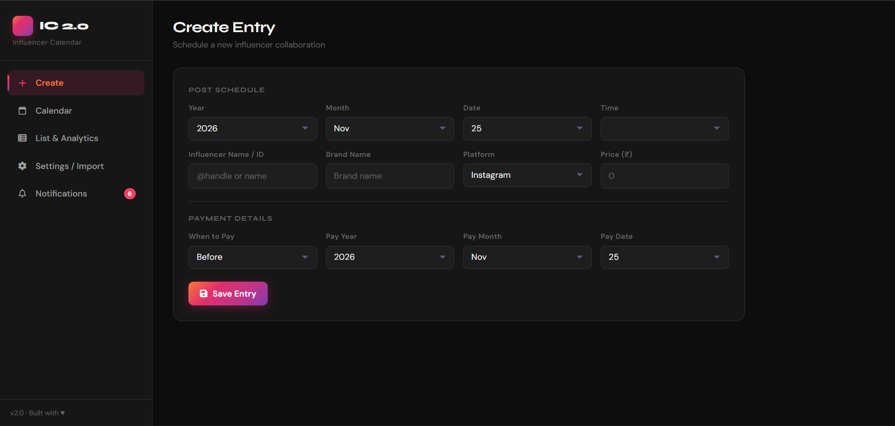
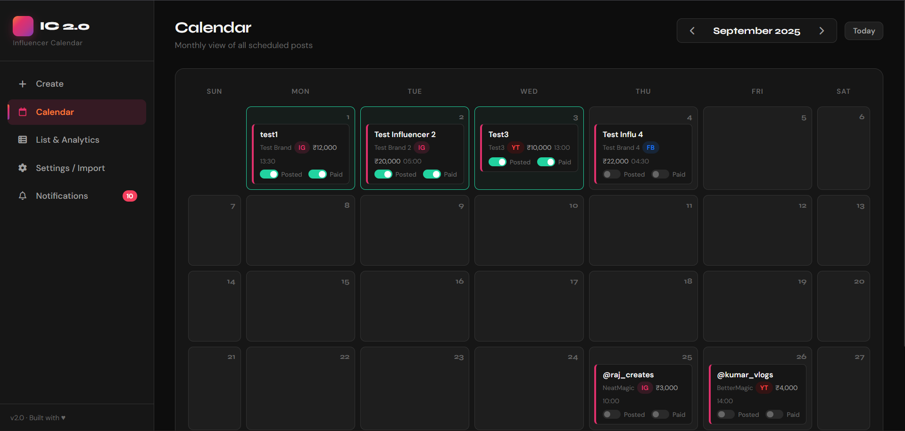
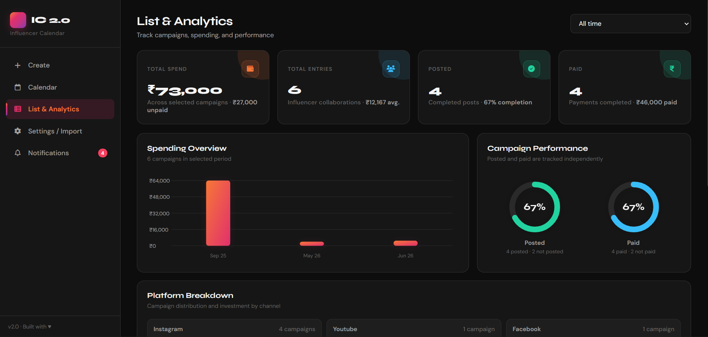
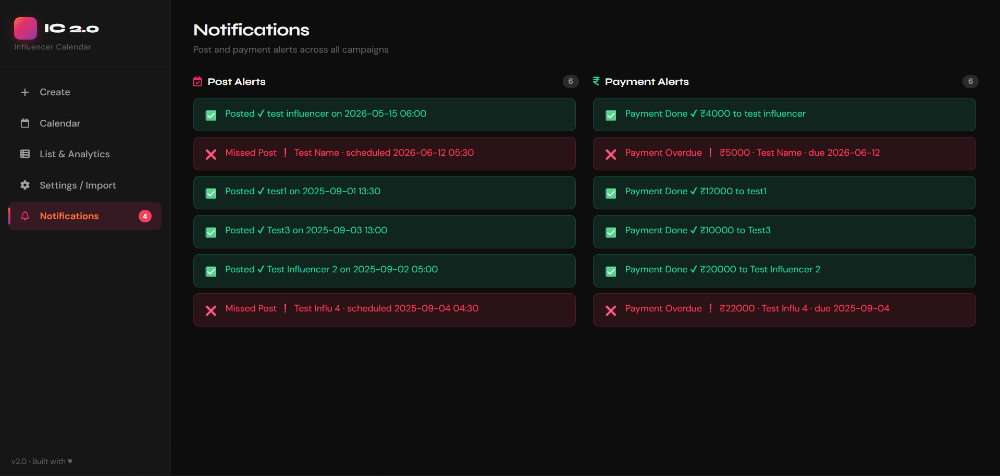

# 🚀 IC 2.0 — Influencer Campaign Management

IC 2.0 is a web-based influencer campaign management application designed to simplify campaign scheduling, influencer collaboration tracking, payment management, and performance analytics through a clean, intuitive dashboard.

It brings campaign organization, calendar management, payment tracking, and actionable analytics together in one place.

---

## 📸 Application Preview

### Dashboard


### Calendar Management


### List & Analytics


### Notifications

---

## ✨ Key Features

### 📅 Calendar Management

- Organize influencer campaigns by date and time.
- View scheduled collaborations through a calendar interface.
- Track upcoming campaign activities.
- Manage campaign schedules efficiently.

### 👥 Influencer Campaign Management

- Create and manage influencer collaborations.
- Store influencer and brand information.
- Assign social media platforms.
- Track campaign pricing and payment dates.
- Edit and delete existing campaign entries.

### 💰 Payment Tracking

- Track campaign payment amounts.
- Monitor paid and unpaid collaborations.
- Configure payment timing (Before / After).
- Manage payment dates.
- Keep payment information organized.

### 📊 Advanced Analytics Dashboard

- Total campaign spending.
- Total campaign entries.
- Posted campaign statistics.
- Completed payment statistics.
- Monthly spending visualization.
- Campaign performance charts.
- Social media platform breakdown.
- Interactive analytics and campaign filtering.

### 🔔 Notifications

- Monitor upcoming campaign activities.
- Keep track of important campaign dates.
- View relevant campaign and payment notifications.

### 📥 Import & Export

- Import campaign information using the supported CSV workflow.
- Export campaign information.
- Manage application data through the settings interface.

### 🎨 Premium User Interface

- Modern dark-themed dashboard.
- Premium orange and pink visual accents.
- Responsive layouts.
- Interactive charts and visual indicators.
- Clean campaign tables.
- Intuitive navigation and user experience.

---

## 🛠️ Technology Stack

| Technology           | Purpose                                |
| -------------------- | -------------------------------------- |
| HTML5                | Application structure                  |
| CSS3                 | Styling, layouts and responsive design |
| JavaScript           | Application logic and interactivity    |
| Browser localStorage | Client-side data persistence           |
| SVG / CSS Charts     | Analytics visualizations               |

---

## 📂 Project Structure

```text
IC-2.0/
│
├── index.html
│
├── patch.js
│
├── screenshots/
│   ├── dashboard.png
│   ├── calendar.png
│   └── analytics.png
│
└── README.md
```

*Note: Include `patch.js` only if the final application still depends on it. Adjust the structure to match the actual repository.*

---

## ⚙️ Installation & Setup

### Prerequisites

- A modern web browser.
- Git.
- A code editor such as Visual Studio Code.

### 1. Clone the Repository

```bash
git clone https://github.com/autbruba22it007/influencer-calendar.git
```

### 2. Navigate to the Project

```bash
cd IC-2.0
```

### 3. Open the Application

Open `index.html` directly in your browser.

Alternatively, use the VS Code Live Server extension for local development.

### 4. Start Managing Campaigns

Once the application opens, you can:

- Create influencer campaigns.
- Organize schedules.
- Track payments.
- Monitor campaign performance.
- Explore analytics.

---

## 💾 Data Storage

IC 2.0 currently uses browser `localStorage` for client-side data persistence.

This allows campaign information to remain available across browser sessions on the same browser and origin.

**Important:** Clearing browser storage or using a different browser/device may result in inaccessible locally stored campaign data. Export important information regularly where the application supports it.

---

## 📈 Analytics & Insights

The analytics module provides an overview of campaign activity through:

- Spending Overview
- Campaign Performance
- Platform Breakdown
- Campaign Statistics
- Payment Tracking

These insights help users monitor campaign expenses, collaboration progress, and payment status.

---

## 🎯 Project Objectives

IC 2.0 was developed to address common challenges in influencer campaign management, including:

- Managing multiple influencer collaborations.
- Organizing campaign schedules.
- Tracking campaign expenses.
- Monitoring posting and payment statuses.
- Understanding campaign activity through analytics.

The goal is to provide a centralized and user-friendly solution for influencer campaign organization.

---

## 🔮 Future Enhancements

Potential improvements include:

- Cloud-based database integration.
- User authentication and authorization.
- Multi-user collaboration.
- Automated notifications.
- Advanced campaign reporting.
- Data synchronization across devices.
- Enhanced analytics and reporting tools.

---

## 👨‍💻 Developer

**Developed by:** [Isaac Bernods]

**Project:** IC 2.0 — Influencer Campaign Management

**GitHub:** [https://github.com/autbruba22it007]

---

## 📄 License

This project is currently shared for portfolio and demonstration purposes. Licensing and reuse permissions can be defined by the repository owner.

---

⭐ If you find this project interesting, consider giving the repository a star!
